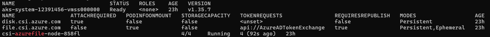
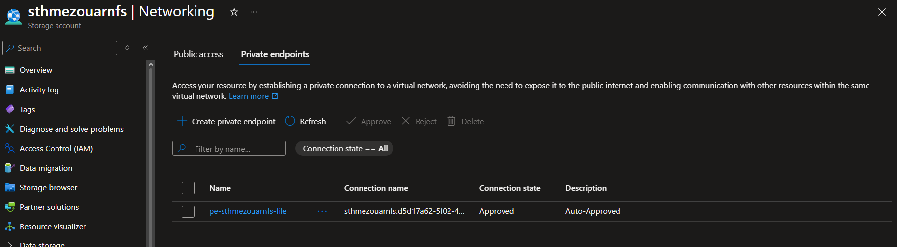
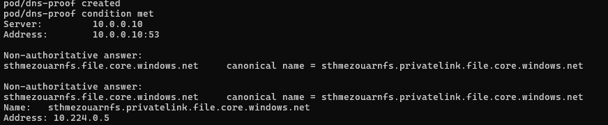
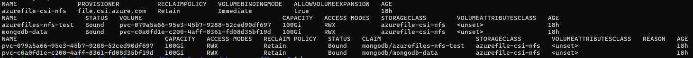
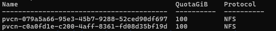
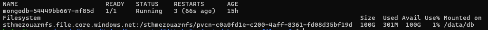
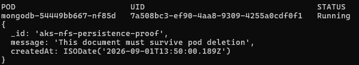

# Persistent MongoDB Storage on AKS with Azure Files NFS

## 1. Project objective

This project provides persistent storage for MongoDB running in Azure Kubernetes Service (AKS). MongoDB data is stored in a Premium Azure Files NFS share mounted at `/data/db`.

Kubernetes dynamically provisions the share through the AKS-native Azure Files CSI driver, `file.csi.azure.com`. Storage traffic uses a private endpoint and private DNS, while public network access to the storage account is disabled.

## 2. Final result

- The Azure Files CSI driver is installed and operational.
- The `azurefile-csi-nfs` StorageClass uses Premium Azure Files with NFS.
- A `10Gi` test PVC triggered dynamic provisioning of an NFS share.
- Azure provisioned `100Gi`, the minimum capacity for a Premium Azure Files share.
- The MongoDB PVC `mongodb-data` is `Bound` with `ReadWriteMany` access.
- MongoDB mounts the share at `/data/db`.
- A MongoDB document survived deletion and replacement of the pod.
- The storage account's public network access is disabled.

### Evidence included in this repository

| Brief requirement | Evidence |
|---|---|
| AKS access and Azure Files CSI driver | Figure 1: Ready AKS node, registered CSI driver and running Azure Files node component |
| Private connectivity to Azure Files | Figure 2: approved `file` private endpoint |
| Private DNS resolution from AKS | Figure 3: storage hostname resolves to private IP `10.224.0.5` |
| Dynamic provisioning | Figure 4: StorageClass, PVCs and PVs in `Bound` state |
| NFS shares visible in Azure | Figure 5: two dynamically provisioned `100Gi` NFS shares |
| MongoDB volume mounted at `/data/db` | Figure 6: Azure Files NFS mount shown by `df -h` |
| MongoDB data persistence | Figure 7: persisted document returned from the replacement pod |

Together, these captures demonstrate the complete path from Kubernetes storage provisioning to data surviving a MongoDB pod replacement.

## 3. Resources

| Resource | Name | Purpose |
|---|---|---|
| Permanent Resource Group | `hmezouarRG` | Contains project resources and must never be deleted |
| AKS cluster | `velerolab-aks-sby6ie` | Runs MongoDB and the CSI driver |
| AKS VNet | `aks-vnet-55422649` | Private network used by AKS |
| AKS subnet | `aks-subnet` (`10.224.0.0/16`) | Contains the AKS nodes and private endpoint |
| Storage account | `sthmezouarnfs` | Hosts Premium Azure Files NFS shares |
| Private endpoint | `pe-sthmezouarnfs-file` | Provides private access to Azure Files |
| Private endpoint IP | `10.224.0.5` | Private address of the Azure Files endpoint |
| Private DNS zone | `privatelink.file.core.windows.net` | Resolves Azure Files to its private IP |
| DNS VNet link | `link-aks-vnet-azurefiles` | Makes private DNS available to AKS |
| Kubernetes namespace | `mongodb` | Isolates the application resources |

The `hmezouarRG` Resource Group is permanent. Cleanup operations must target individually verified resources and must never delete this Resource Group.

## 4. Architecture

```text
MongoDB container (/data/db)
          |
          v
PVC mongodb-data (RWX, 100Gi)
          |
          v
StorageClass azurefile-csi-nfs
          |
          v
CSI driver file.csi.azure.com
          |
          v
Premium Azure Files NFS share
          |
          v
Private endpoint 10.224.0.5
          |
          v
aks-subnet / aks-vnet-55422649
```

## 5. AKS and CSI validation

The cluster and CSI driver were verified with:

```bash
kubectl get nodes
kubectl get csidrivers
kubectl get pods -n kube-system
```

Observed results:

- the AKS node was `Ready`;
- `file.csi.azure.com` was registered;
- the Azure Files CSI node component was `Running`;
- successful dynamic provisioning later confirmed that the CSI controller was operational.

**Figure 1 — AKS node, registered CSI drivers and running Azure Files CSI node component.**



## 6. Azure Files storage account

The `sthmezouarnfs` storage account was created with:

| Setting | Value |
|---|---|
| Primary service | Azure Files |
| Region | West Europe |
| Account kind | FileStorage |
| Performance | Premium SSD |
| Redundancy | Premium LRS |
| Billing model | Provisioned v1 |
| Share protocol | NFS |

The existing `sthmezouarfiles` account was not reused because it is a Standard `StorageV2` account and already contains the unrelated `company-data` share.

The Azure Portal overview was also verified. Any submitted Portal capture must hide the subscription identifier.

## 7. Private networking and DNS

The `pe-sthmezouarnfs-file` private endpoint targets the storage account's `file` subresource. It is deployed in `aks-subnet` and uses private IP `10.224.0.5`.

The `privatelink.file.core.windows.net` private DNS zone is linked to the AKS VNet and contains:

```text
sthmezouarnfs.privatelink.file.core.windows.net -> 10.224.0.5
```

A DNS test from an AKS pod returned:

```text
sthmezouarnfs.file.core.windows.net
  canonical name = sthmezouarnfs.privatelink.file.core.windows.net
  address = 10.224.0.5
```

Public access was then disabled:

```text
PublicNetworkAccess: Disabled
DefaultAction: Deny
```

**Figure 2 — Azure Files private endpoint in the `Approved` state.**



**Figure 3 — DNS lookup executed inside AKS, resolving Azure Files to private IP `10.224.0.5`.**



## 8. NFS StorageClass

The StorageClass is defined in `kubernetes/storageclass.yaml`. Its principal settings are:

```yaml
provisioner: file.csi.azure.com
parameters:
  resourceGroup: hmezouarRG
  storageAccount: sthmezouarnfs
  skuName: Premium_LRS
  protocol: nfs
reclaimPolicy: Retain
allowVolumeExpansion: true
```

`Retain` protects the underlying storage from automatic deletion when the PVC is removed. `allowVolumeExpansion` allows online expansion testing.

## 9. Dynamic provisioning test

The test claim in `tests/pvc-test.yaml` requests:

```text
StorageClass: azurefile-csi-nfs
Requested capacity: 10Gi
Access mode: ReadWriteMany
```

The CSI driver automatically created:

```text
PVC: azurefiles-nfs-test
State: Bound
PV: pvc-079a5a66-95e3-45b7-9288-52ced90df697
Azure share: pvcn-079a5a66-95e3-45b7-9288-52ced90df697
Actual capacity: 100Gi
Protocol: NFS
```

Although Kubernetes accepted a `10Gi` request, Azure Files Premium provisioned its minimum capacity of `100Gi`.

The pod in `tests/pod-test.yaml` mounted the claim at `/mnt/azure`. The `proof.txt` file remained available after deleting and recreating the pod.

**Figure 4 — StorageClass and dynamically provisioned PVC/PV resources in the `Bound` state.**



**Figure 5 — Azure control-plane view of the two CSI-created `100Gi` NFS shares.**



## 10. MongoDB deployment

The manifests were deployed with:

```bash
kubectl apply -k kubernetes/
```

Kustomize deployed:

- the `mongodb` namespace;
- the `azurefile-csi-nfs` StorageClass;
- the `mongodb-data` PVC;
- the `mongodb` Deployment;
- the `mongodb` Service;
- a generated Kubernetes Secret.

The MongoDB claim produced:

```text
PVC: mongodb-data
State: Bound
Capacity: 100Gi
Access mode: RWX
StorageClass: azurefile-csi-nfs
PV: pvc-c0a0fd1e-c200-4aff-8361-fd08d35bf19d
```

The required mount check was performed with:

```bash
kubectl exec -n mongodb deployment/mongodb -- df -h /data/db
```

Result:

```text
sthmezouarnfs.file.core.windows.net:/sthmezouarnfs/pvcn-c0a0fd1e-c200-4aff-8361-fd08d35bf19d
100G  300M  100G  1%  /data/db
```

**Figure 6 — Running MongoDB pod with the Azure Files NFS share mounted on `/data/db`.**



## 11. MongoDB persistence proof

The following document was inserted into the `persistence_demo` database:

```javascript
{
  _id: "aks-nfs-persistence-proof",
  message: "This document must survive pod deletion",
  createdAt: ISODate("2026-09-01T13:50:00.189Z")
}
```

Pod before deletion:

```text
Name: mongodb-54449bb667-xspnx
UID: bcddcfdf-7ae5-4680-9dde-053f108f31fe
```

Pod created by the Deployment afterward:

```text
Name: mongodb-54449bb667-2xrsd
UID: c83b6cd8-b725-4d2c-947d-3d2525ffdfb8
```

The changed name and UID prove that Kubernetes created a new pod. The new pod returned the same document with the same identifier and creation timestamp.

**Conclusion: MongoDB data is persisted in Azure Files and is independent of the pod lifecycle.**

**Figure 7 — Replacement MongoDB pod returning the document created before pod deletion.**



## 12. Mounting issue and resolution

The initial NFS mount failed with:

```text
mount.nfs: access denied by server
```

The private endpoint, DNS, NFS share and network path were correct. However, storage accounts created through the Azure Portal enable the separate `Require encryption in transit for NFS` setting by default.

The CSI driver used the standard NFS client rather than the AZNFS TLS helper. The setting was therefore explicitly disabled for this lab:

```bash
az storage account file-service-properties update \
  --resource-group "hmezouarRG" \
  --account-name "sthmezouarnfs" \
  --nfs-eit \
  --require-nfs-encryption-in-transit false
```

The mount succeeded after the test pod was recreated.

Network security remains enforced through the private endpoint and disabled public access. For production, AZNFS and NFS encryption in transit should be evaluated.

## 13. Security considerations and limitations

- Public network access to `sthmezouarnfs` is disabled.
- NFS access is primarily authorized at the network level.
- MongoDB credentials are generated from the ignored `kubernetes/mongodb.env` file. Only the safe `mongodb.env.example` template is committed.
- MongoDB runs with one replica. Independent MongoDB instances must not write directly into the same data directory without a correctly configured replica set.
- `ReadWriteMany` describes an Azure Files capability; it does not automatically make MongoDB safe for multiple writers.
- Subscription identifiers, passwords, access keys, connection strings and tokens must be hidden in screenshots.

## 14. Cleanup warning

The `hmezouarRG` Resource Group must never be deleted.

Cleanup must be performed one resource at a time after verifying its exact identity and dependencies. Because the StorageClass uses `reclaimPolicy: Retain`, deleting a PVC does not automatically delete its PV or Azure File Share. This protects data from accidental loss, but retained shares may continue to incur costs.
